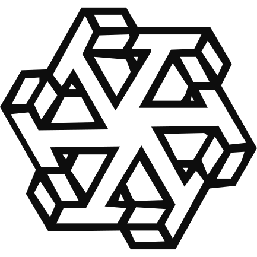
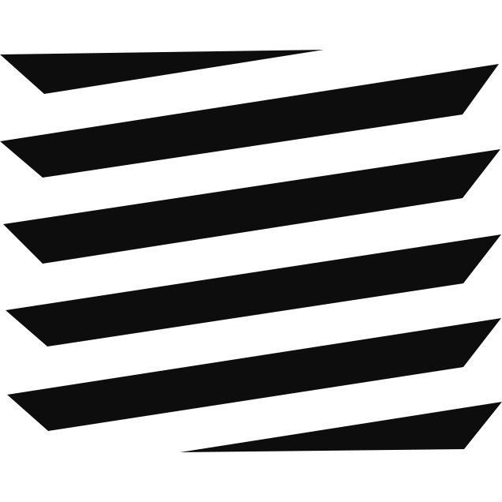
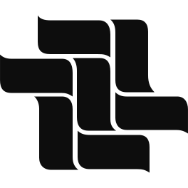
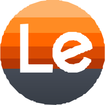
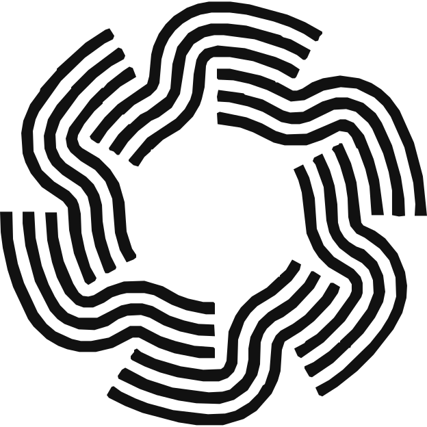
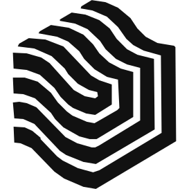

<h1 align="center">⁜ Onur</h1>

<strong>I am. I think. I will.</strong>

I build for myself, to my own standards. The code is here.

## Work

<table>
<tr>
  <td align="center" width="72"></td>
  <td><strong><a href="https://github.com/OnurByte/OmaMonero">OmaMonero</a></strong> Monero price, node health and receive QR codes in the Omarchy top bar. </td>
</tr>
<tr>
  <td align="center" width="72"><a href="https://github.com/OnurByte/Vexen"><picture><source media="(prefers-color-scheme: dark)" srcset="assets/projects/vexen-dark.svg"></picture></a></td>
  <td><strong><a href="https://github.com/OnurByte/Vexen">Vexen</a></strong> Your AI agent forgot what failed. Vexen didn't. </td>
</tr>
<tr>
  <td align="center" width="72"><a href="https://github.com/OnurByte/Lumen"><picture><source media="(prefers-color-scheme: dark)" srcset="assets/projects/lumen-dark.svg"></picture></a></td>
  <td><strong><a href="https://github.com/OnurByte/Lumen">Lumen</a></strong> Two AI hosts debate live. Your viewers join in. Works with TikTok, Kwai and Likee. <a href="https://github.com/OnurByte/Lumen/releases/latest">Download</a></td>
</tr>
<tr>
  <td align="center" width="72"><a href="https://github.com/OnurByte/Tehom"><picture><source media="(prefers-color-scheme: dark)" srcset="assets/projects/tehom-dark.svg"></picture></a></td>
  <td><strong><a href="https://github.com/OnurByte/Tehom">Tehom</a></strong> Paste a link. Get clips as MP4 files. Under development. <a href="https://github.com/OnurByte/Tehom/releases/latest">Download</a></td>
</tr>
<tr>
  <td align="center" width="72"><a href="https://github.com/OnurByte/LimitlessX"><picture><source media="(prefers-color-scheme: dark)" srcset="assets/projects/limitlessx-dark.svg"></picture></a></td>
  <td><strong><a href="https://github.com/OnurByte/LimitlessX">LimitlessX</a></strong> See public 𝕏 profiles and posts blocked in your region. No VPN. <a href="https://github.com/OnurByte/LimitlessX/releases/latest">Install</a></td>
</tr>
<tr>
  <td align="center" width="72"><a href="https://github.com/OnurByte/ispatla.tr"><picture><source media="(prefers-color-scheme: dark)" srcset="assets/projects/ispatla-dark.svg"></picture></a></td>
  <td><strong><a href="https://github.com/OnurByte/ispatla.tr">ispatla.tr</a></strong> Finds 𝕏 conversations worth joining and helps you reply in your own voice. <a href="https://ispatla.tr">Open</a></td>
</tr>
<tr>
  <td align="center" width="72"><a href="https://github.com/OnurByte/onur.af"><picture><source media="(prefers-color-scheme: dark)" srcset="assets/projects/onur-af-dark.svg"></picture></a></td>
  <td><strong><a href="https://github.com/OnurByte/onur.af">onur.af</a></strong> Where I write. Every Log is signed and timestamped. <a href="https://portfolio-seven-plum-73.vercel.app/">Check it yourself</a></td>
</tr>
<tr>
  <td align="center" width="72"></td>
  <td><strong><a href="https://github.com/OnurByte/OmaLecoo">OmaLecoo</a></strong> RGB effects and macros for a Lecoo GK301 keyboard, from the Omarchy top bar. <a href="https://github.com/OnurByte/OmaLecoo#install">Install</a></td>
</tr>
<tr>
  <td align="center" width="72"><a href="https://github.com/OnurByte/TurkishBankMCP"><picture><source media="(prefers-color-scheme: dark)" srcset="assets/projects/turkishbankmcp-dark.svg"></picture></a></td>
  <td><strong><a href="https://github.com/OnurByte/TurkishBankMCP">TurkishBankMCP</a></strong> Lets AI tools read Garanti BBVA accounts and transactions. No transfers or payments. <a href="https://github.com/OnurByte/TurkishBankMCP#ne-yapar-ne-yapmaz">What it can and cannot do</a></td>
</tr>
<tr>
  <td align="center" width="72"><a href="https://github.com/OnurByte/PSYCHOVIM"><picture><source media="(prefers-color-scheme: dark)" srcset="assets/projects/psychovim-dark.svg"></picture></a></td>
  <td><strong><a href="https://github.com/OnurByte/PSYCHOVIM">PychoVIM</a></strong> An American Psycho-inspired terminal editor built on Neovim. <a href="https://github.com/OnurByte/PSYCHOVIM#install">Install</a></td>
</tr>
</table>

Earlier projects

- **[Hakikat](https://github.com/OnurByte/Hakikat)** ⁜ Prayer times and Quran reading for Linux.
- **[AciklamaAI](https://github.com/OnurByte/AciklamaAI)** ⁜ AI-assisted product descriptions.
- **[DomainFinder](https://github.com/OnurByte/DomainFinder)** ⁜ Checks which domain names are available.
- **[newsPM](https://github.com/OnurByte/newsPM)** ⁜ News-feed plugin for PocketMine servers.
- **[PrayerTimes](https://github.com/OnurByte/PrayerTimes)** ⁜ Prayer times inside Minecraft Bedrock.
- **[Twitter-To-Prototurk](https://github.com/OnurByte/Twitter-To-Prototurk)** ⁜ Sends tweets to the Prototürk community.
- **[TalhaCenter](https://github.com/OnurByte/TalhaCenter)** ⁜ School e-commerce project. Character development.

## Technologies

<picture>
  <source media="(prefers-color-scheme: dark)" srcset="assets/technologies-dark.svg">
  
</picture>

---

<a href="https://github.com/OnurByte?tab=overview">
  <picture>
    <source media="(prefers-color-scheme: dark)" srcset="assets/github-history-dark.svg?v=views-inside-1">
    
  </picture>
  <!-- Official pixel mode keeps the same view counter active; its visible value is rendered inside the card. -->
  
</a>

---

## Links

  <a href="https://portfolio-seven-plum-73.vercel.app/"><picture><source media="(prefers-color-scheme: dark)" srcset="assets/links/onur-dark.svg"></picture></a>
  <a href="https://github.com/OnurByte"><picture><source media="(prefers-color-scheme: dark)" srcset="assets/links/github-dark.svg"></picture></a>
  <a href="https://x.com/onurstirner"><picture><source media="(prefers-color-scheme: dark)" srcset="assets/links/x-dark.svg"></picture></a>
  <a href="https://x.com/OnurBinary"><picture><source media="(prefers-color-scheme: dark)" srcset="assets/links/x-binary-dark.svg"></picture></a>

Issues and pull requests are welcome. ⁜ The creator originates.
