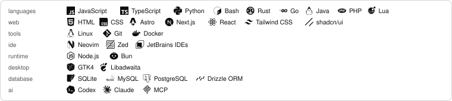
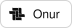
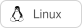

# onur

i build for myself, to my own standards. the code is here.

---

## featured work

desktop tools, browser extensions, web apps, and integrations. source code and setup live with each project.

<table>
<tr>
  <td align="center" width="106"></td>
  <td><strong><a href="https://github.com/OnurByte/onur.af">onur.af</a></strong> my personal site for projects and writing, with signatures so you can verify what i actually published.</td>
</tr>
<tr>
  <td align="center" width="106"><a href="https://github.com/OnurByte/LimitlessX"><picture><source media="(prefers-color-scheme: dark)" srcset="https://raw.githubusercontent.com/OnurByte/LimitlessX/main/docs/brand/mark-dark.svg"></picture></a></td>
  <td><strong><a href="https://github.com/OnurByte/LimitlessX">LimitlessX</a></strong> browser extension for viewing region-restricted public 𝕏 profiles and posts. no VPN setup.</td>
</tr>
<tr>
  <td align="center" width="106"></td>
  <td><strong><a href="https://github.com/OnurByte/ispatla.tr">ispatla.tr</a></strong> find relevant 𝕏 conversations, see why they fit each account, and write replies in your own voice.</td>
</tr>
<tr>
  <td align="center" width="106"></td>
  <td><strong><a href="https://github.com/OnurByte/OmaMonero">OmaMonero</a></strong> track Monero prices and node health in Omarchy's top bar, and create receive QR codes. no wallet keys.</td>
</tr>
<tr>
  <td align="center" width="106"></td>
  <td><strong><a href="https://github.com/OnurByte/OmaLecoo">OmaLecoo</a></strong> change a Lecoo GK301 keyboard's RGB lighting from the Omarchy Linux bar. effects, macros, offline controls.</td>
</tr>
<tr>
  <td align="center" width="106"></td>
  <td><strong><a href="https://github.com/OnurByte/TurkishBankMCP">TurkishBankMCP</a></strong> lets AI tools read Garanti BBVA account and transaction data with approved API access. no transfers or payments.</td>
</tr>
</table>

## more work

<table>
<tr>
  <td align="center" width="106"></td>
  <td><strong><a href="https://github.com/OnurByte/LiquidGlassForLinux">LiquidGlassForLinux</a></strong> turn ordinary Linux app icons into layered, glass-like icons. change their look locally.</td>
</tr>
<tr>
  <td align="center" width="106"></td>
  <td><strong><a href="https://github.com/OnurByte/PSYCHOVIM">PychoVIM</a></strong> a ready-to-use terminal text editor built on Neovim, with extensions, themes and automatic updates.</td>
</tr>
</table>

earlier projects

- **[Hakikat](https://github.com/OnurByte/Hakikat)** ⁜ quran audio player for Linux.
- **[AciklamaAI](https://github.com/OnurByte/AciklamaAI)** ⁜ AI-assisted product descriptions.
- **[DomainFinder](https://github.com/OnurByte/DomainFinder)** ⁜ checks which domain names are available.
- **[newsPM](https://github.com/OnurByte/newsPM)** ⁜ news-feed plugin for PocketMine servers.
- **[PrayerTimes](https://github.com/OnurByte/PrayerTimes)** ⁜ prayer times inside Minecraft Bedrock.
- **[Twitter-To-Prototurk](https://github.com/OnurByte/Twitter-To-Prototurk)** ⁜ sends tweets to the Prototürk community.
- **[TalhaCenter](https://github.com/OnurByte/TalhaCenter)** ⁜ school e-commerce project. character development.

## technologies

<picture>
  <source media="(prefers-color-scheme: dark)" srcset="assets/technologies-dark.svg">
  
</picture>

---

<a href="https://github.com/OnurByte?tab=overview">
  <picture>
    <source media="(prefers-color-scheme: dark)" srcset="assets/github-history-dark.svg?v=views-inside-1">
    
  </picture>
  <!-- Official pixel mode keeps the same view counter active; its visible value is rendered inside the card. -->
  
</a>

---

## links

  <a href="https://onur.af"><picture><source media="(prefers-color-scheme: dark)" srcset="assets/links/onur-dark.svg"></picture></a>
  <a href="https://github.com/OnurByte"><picture><source media="(prefers-color-scheme: dark)" srcset="assets/links/github-dark.svg"></picture></a>
  <a href="https://www.kernel.org/"><picture><source media="(prefers-color-scheme: dark)" srcset="assets/links/linux-dark.svg"></picture></a>
  <a href="https://neovim.io/"><picture><source media="(prefers-color-scheme: dark)" srcset="assets/links/neovim-dark.svg"></picture></a>

issues and pull requests are welcome.
